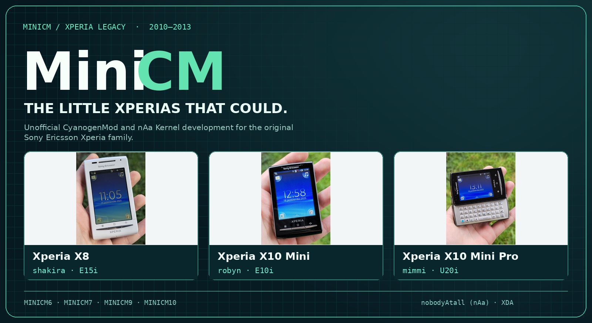
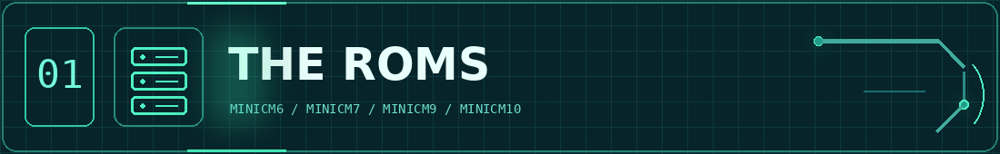
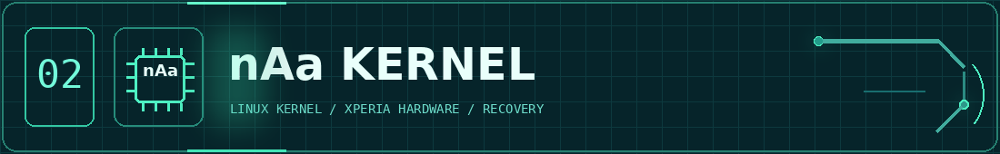
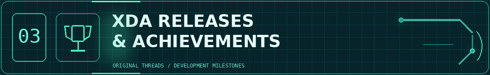
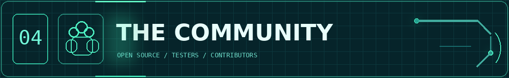

 
 
 

<h2 align="center">Small screens. Big possibilities.</h2>

Unofficial <strong>CyanogenMod</strong> and <strong>nAa Kernel</strong> development for classic Sony Ericsson Xperia devices.

**MiniCM**, created by [nobodyAtall (nAa)](https://xdaforums.com/m/nobodyatall.788040/), brought newer Android versions to tiny Sony Ericsson Xperia phones through unofficial CyanogenMod builds, custom kernels and hardware-specific engineering.

| MiniCM generation | Android | Original MiniCM work |
| --- | --- | --- |
| **MiniCM6** | Froyo · Android 2.2 | Early CyanogenMod 6 porting, including the X10 Mini |
| **MiniCM7** | Gingerbread · Android 2.3.7 / CM7.2 | Custom ROM development and nAa kernel integration for the X8, X10 Mini and X10 Mini Pro |
| **MiniCM9** | Ice Cream Sandwich · Android 4.0 | Android 4-era ports for the original Xperia mini family |
| **MiniCM10** | Jelly Bean · Android 4.1 | CM10 releases and matching nAa-JB kernel work |

### Confirmed MiniCM7 devices

| Device | Codename | Archived MiniCM7 release |
| --- | --- | --- |
| **Xperia X8** | `shakira` | `MiniCM7-2.2.1-shakira.zip` |
| **Xperia X10 Mini** | `robyn` | `MiniCM7-2.2.1-robyn.zip` |
| **Xperia X10 Mini Pro** | `mimmi` | `MiniCM7-2.2.1-mimmi.zip` |

The [historical MiniCM downloads listing](https://archive.ph/qiUo8) records these three releases and corresponding kernel files.

---

MiniCM's kernel work included separate Android-generation lines. Kernel and recovery changes were essential for getting hardware drivers and newer Android builds working on early Qualcomm devices.

| Source | Purpose |
| --- | --- |
| [nAa Kernel](https://github.com/nobodyAtall-code/nAa-kernel) | Original Gingerbread-era Xperia kernel |
| [nAa Kernel ICS](https://github.com/nobodyAtall-code/nAa-kernel-ics) | Ice Cream Sandwich-era kernel |
| [nAa Kernel JB](https://github.com/nobodyAtall-code/nAa-kernel-jb) | Jelly Bean-era kernel |
| [MSM7x27-2.6.32.x-nAa](https://github.com/nobodyAtall-code/msm7x27-2.6.32.x-nAa) | Qualcomm MSM7x27 kernel source |
| [MiniCM-Project source repositories](https://github.com/orgs/MiniCM-Project/repositories) | Legacy CyanogenMod / Android source trees |

---

| Release and milestone | Original source |
| --- | --- |
| **MiniCM6 — X10 Mini / Froyo** | [XDA ROM thread](https://xdaforums.com/t/rom-minicm6-1-0-2-update-13-6-11-froyo-2-2-1-cm-6-1-3-port-for-the-mini.961707/) |
| **MiniCM7 — X10 Mini / Gingerbread** | [XDA ROM thread](https://xdaforums.com/t/rom-minicm7-2-2-2-6-7-13-gingerbread-2-3-7-cm7-2-unofficial-port-for-the-x10mini.1068553/) |
| **MiniCM7 — X8 / X10 Mini / Mini Pro** | [Archived device-specific packages](https://archive.ph/qiUo8) |
| **MiniCM10 + nAa-JB — Xperia X8** | [Featured by XDA Developers](https://www.xda-developers.com/naa-jb-kernel-and-minicm10-rom-for-the-xperia-x8/) |
| **2011 Xperia Mini — Linux 3.0.8 boot** | [Xperia Blog (2013)](https://www.xperiablog.net/2013/04/14/dev-manages-to-boot-3-0-8-kernel-on-2011-sony-xperia-device/) |
| **nobodyAtall's XDA history** | [Profile and achievements](https://xdaforums.com/m/nobodyatall.788040/#adav_achievements) |

**[Browse the complete historical MiniCM and nAa XDA index](https://github.com/MiniCM-Project/.github/blob/main/profile/XDA_INDEX.md)** — organized by device with release and kernel references.

FreeXperia work is included in the historical archive as a **related but separate** project, rather than incorrectly labeling it MiniCM.

---

MiniCM was part of a broader open-source Android modding community. Kernel developers, testers, translators and other contributors helped make Android usable on devices with very limited RAM, storage and display sizes.

Read [**An audience with nobodyAtall**](https://xperiaminicyanogen.wordpress.com/interviews/an-audience-with-nobodyatall/) for the original development story and [the MiniCM Google Code archive](https://code.google.com/archive/p/minicm/) for historical project resources.

### Photo credits and artwork license

The **single image at the top of this profile** combines three real-device photographs by [Beamish4](https://commons.wikimedia.org/wiki/User:Beamish4), published on Wikimedia Commons, with original MiniCM graphic design. Photographs were resized and placed into an illustrated panel.

- [Xperia X8 photograph](https://commons.wikimedia.org/wiki/File:Sony_Ericsson_Xperia_X8_-_Front.jpg) — [CC BY 4.0](https://creativecommons.org/licenses/by/4.0/)
- [Xperia X10 Mini photograph](https://commons.wikimedia.org/wiki/File:Sony_Ericsson_Xperia_X10_mini_-_Front.jpg) — [CC BY-SA 4.0](https://creativecommons.org/licenses/by-sa/4.0/)
- [Xperia X10 Mini Pro photograph, keyboard open](https://commons.wikimedia.org/wiki/File:Sony_Ericsson_Xperia_X10_mini_pro_-_Front_(Open).jpg) — [CC BY 4.0](https://creativecommons.org/licenses/by/4.0/)

The composite banner artwork is shared under [CC BY-SA 4.0](https://creativecommons.org/licenses/by-sa/4.0/). Device trademarks belong to their respective owners.

---

> [!IMPORTANT]
> This is a **historical project portfolio**, not a maintained firmware release or flashing guide. Old kernels, recovery images and ROM downloads may be obsolete, and mixed ROM/kernel builds can be incompatible.

<strong>MiniCM · nAa Kernel · Xperia</strong> Built for little devices. Remembered by the community.

